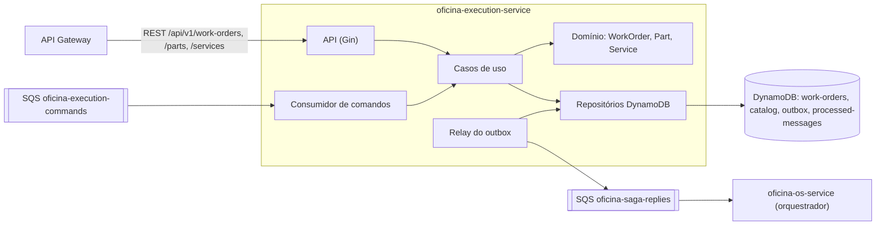

# Tech Challenge — Oficina Mecânica · Execution Service

[](https://github.com/gaabriel165/oficina-execution-service/actions/workflows/ci.yml)
[](https://sonarcloud.io/summary/new_code?id=gaabriel165_oficina-execution-service)
[](https://sonarcloud.io/summary/new_code?id=gaabriel165_oficina-execution-service)

Microsserviço de **diagnóstico e execução** da oficina mecânica. Mantém a fila de ordens de trabalho dos mecânicos, o catálogo de serviços e peças e o estoque: registra o diagnóstico, reserva as peças quando o pagamento é confirmado e devolve o estoque quando a saga precisa compensar.

Parte do Tech Challenge da pós-graduação em Arquitetura de Software (FIAP SOAT) — Fase 4.

## Repositórios do projeto

| Repositório | Papel |
|---|---|
| [`oficina-os-service`](https://github.com/gaabriel165/oficina-os-service) | Ordens de serviço, clientes, veículos e orquestração da saga |
| [`oficina-billing-service`](https://github.com/gaabriel165/oficina-billing-service) | Orçamento e pagamento |
| **`oficina-execution-service`** (este) | Diagnóstico, execução, catálogo e estoque |
| [`oficina-lambda-auth`](https://github.com/gaabriel165/oficina-lambda-auth) | Autenticação por CPF e API Gateway |
| [`oficina-infra-k8s`](https://github.com/gaabriel165/oficina-infra-k8s) | VPC, EKS e base compartilhada |
| [`oficina-infra-db`](https://github.com/gaabriel165/oficina-infra-db) | Banco do OS Service |

A visão do sistema inteiro, o desenho da saga e a justificativa do padrão estão no [README do OS Service](https://github.com/gaabriel165/oficina-os-service#readme).

## Stack

- Go 1.26, Gin
- Amazon DynamoDB (banco NoSQL exclusivo deste serviço)
- Amazon SQS para comandos e respostas da saga
- OpenTelemetry (traces) e `slog` em JSON (logs), enviados ao New Relic
- Terraform, Kubernetes (EKS) e GitHub Actions

## Arquitetura



O código segue Clean Architecture: `domain` → `application` → `infrastructure` → `api`.

### Por que DynamoDB

A ordem de trabalho é lida e gravada sempre inteira, pela chave (o id da ordem de serviço), com os serviços e as peças embutidos no mesmo item. Não há junções nem consultas ad hoc, e a carga é de muitas escritas pequenas. As mudanças que precisam ser atômicas usam `TransactWriteItems`: a reserva de estoque grava a ordem de trabalho, debita cada peça com condição de saldo suficiente e inclui a resposta da saga no outbox, tudo ou nada.

## Comunicação

**Assíncrona (saga).** O serviço consome comandos da fila `oficina-execution-commands` e responde na fila `oficina-saga-replies`.

| Comando recebido | O que faz | Resposta |
|---|---|---|
| `RequestDiagnosis` | Abre a ordem de trabalho na fila de diagnóstico | — (o mecânico age pela API) |
| `StartExecution` | Reserva o estoque das peças e põe a ordem em execução | `ExecutionStarted` ou `ExecutionRejected` (estoque insuficiente) |
| `CancelWorkOrder` | Compensação: cancela a ordem e devolve o estoque reservado | `WorkOrderCancelled` |

As ações do mecânico pela API também geram respostas: `DiagnosisStarted`, `DiagnosisCompleted` (com os serviços e as peças a preço congelado), `DiagnosisFailed` e `ExecutionFinished`.

As mensagens de saída são gravadas na tabela de outbox na mesma transação da mudança de estado e publicadas em seguida; o consumidor registra cada mensagem processada para ignorar repetições. Depois de 5 entregas sem sucesso a mensagem vai para a fila `oficina-execution-commands-dlq`.

Os contratos estão em [`messaging-contracts.md`](https://github.com/gaabriel165/oficina-os-service/blob/main/docs/architecture/messaging-contracts.md).

**Síncrona (REST).** Rotas sob `/api/v1`, protegidas por JWT e restritas ao operador:

| Método e rota | Descrição |
|---|---|
| `GET /work-orders` | Fila de ordens de trabalho, da mais antiga para a mais nova. Filtro `status` |
| `GET /work-orders/{id}` | Consulta uma ordem de trabalho |
| `GET /work-orders/metrics` | Tempo médio de execução, geral e por serviço |
| `PATCH /work-orders/{id}/start-diagnosis` | Inicia o diagnóstico |
| `POST /work-orders/{id}/services` | Inclui um serviço do catálogo no diagnóstico |
| `POST /work-orders/{id}/parts` | Inclui uma peça e a quantidade no diagnóstico |
| `PATCH /work-orders/{id}/complete-diagnosis` | Conclui o diagnóstico e dispara o orçamento |
| `PATCH /work-orders/{id}/fail-diagnosis` | Registra que o diagnóstico não pôde ser feito |
| `PATCH /work-orders/{id}/finish-execution` | Conclui o reparo |
| `POST`, `GET`, `PUT`, `DELETE /parts` | Catálogo de peças |
| `PATCH /parts/{id}/stock` | Entrada de estoque |
| `POST`, `GET`, `PUT`, `DELETE /services` | Catálogo de serviços |

A documentação interativa fica em `/swagger/index.html`.

## Como executar

```bash
cp .env.example .env
docker-compose up --build
```

Sobem a aplicação (porta `8082`), o DynamoDB Local e o ElasticMQ, que emula o SQS localmente. Com `DYNAMODB_CREATE_TABLES=true` as tabelas são criadas no startup.

```bash
curl http://localhost:8082/health
curl http://localhost:8082/ready
```

Para rodar os três microsserviços juntos, use `make system/up` no repositório [`oficina-os-service`](https://github.com/gaabriel165/oficina-os-service).

## Variáveis de ambiente

| Variável | Descrição |
|---|---|
| `SERVER_PORT` | Porta HTTP |
| `APP_ENV` | Ambiente, incluído nos logs e traces |
| `JWT_SECRET` | Chave HS256 compartilhada com os outros serviços e a Lambda |
| `AWS_REGION`, `SQS_ENDPOINT` | Região e endpoint do SQS (endpoint só para o emulador local) |
| `EXECUTION_COMMANDS_QUEUE`, `SAGA_REPLIES_QUEUE` | Nomes das filas |
| `DYNAMODB_ENDPOINT` | Endpoint do DynamoDB (só para o emulador local) |
| `DYNAMODB_TABLE_PREFIX` | Prefixo das tabelas |
| `DYNAMODB_CREATE_TABLES` | Cria as tabelas no startup; em produção elas vêm do Terraform |
| `OTEL_SERVICE_NAME`, `OTEL_EXPORTER_OTLP_ENDPOINT`, `OTEL_EXPORTER_OTLP_HEADERS` | Exportação de traces |

## Testes e cobertura

```bash
make test/unit
make test/integration
make test/coverage
make coverage/check
```

- **Unitários**: entidades, todos os casos de uso, rotas HTTP e consumidor de comandos.
- **Integração**: repositórios, reserva e devolução de estoque, outbox e consumo de fila contra DynamoDB Local e ElasticMQ, com testcontainers. Precisam do Docker em execução.
- **Cobertura**: medida sobre os pacotes do serviço somando testes unitários e de integração. O pipeline falha abaixo de **80%**; a medição atual é de **94,2%** ([SonarCloud](https://sonarcloud.io/summary/overall?id=gaabriel165_oficina-execution-service)).

O cenário em BDD do fluxo completo da ordem de serviço fica no [OS Service](https://github.com/gaabriel165/oficina-os-service/blob/main/internal/integration/features/saga_ordem_de_servico.feature).

## CI/CD

A branch `main` é protegida: toda mudança entra por pull request com os checks aprovados.

- **CI** (`.github/workflows/ci.yml`), em cada pull request e em `main`: build, `go vet`, testes unitários, testes de integração com cobertura, gate de 80%, análise do SonarCloud com quality gate, validação dos manifests e do Terraform e build da imagem.
- **CD** (`.github/workflows/cd.yml`), em cada push para `main`: autentica na AWS por OIDC, aplica o Terraform do serviço, publica a imagem no ECR, cria o `Secret` a partir do SSM e dos secrets do GitHub e faz o rollout no EKS. A execução manual com `destroy` remove o workload e a infraestrutura.

## Infraestrutura

Tudo o que é exclusivo deste serviço é provisionado pelo Terraform em `terraform/`:

| Recurso | Uso |
|---|---|
| DynamoDB `oficina-execution-work-orders`, `-catalog`, `-outbox`, `-processed-messages` | Banco exclusivo, cobrança por requisição |
| SQS `oficina-execution-commands` e `-dlq` | Comandos da saga e fila de mensagens com falha |
| IAM role `oficina-execution-service-pod` | Assumida pelos pods (IRSA), com acesso só às tabelas e filas deste serviço |

Os manifests em `k8s/` (kustomize) criam o namespace `oficina-execution`, o `ServiceAccount`, o `Deployment` com probes, o `Service` (NLB) e o `HPA`. VPC, cluster e repositório de imagens vêm do [`oficina-infra-k8s`](https://github.com/gaabriel165/oficina-infra-k8s).

## Estrutura de pastas

```
cmd/api                  ponto de entrada
configs                  leitura de variáveis de ambiente
internal/domain          entidades, portas e contratos de mensagens
internal/application     casos de uso e relay do outbox
internal/infrastructure  DynamoDB, SQS e observabilidade
internal/api             handlers, middlewares, consumidor e DTOs
docs                     Swagger gerado
k8s                      manifests do Kubernetes
terraform                infraestrutura do serviço
```
